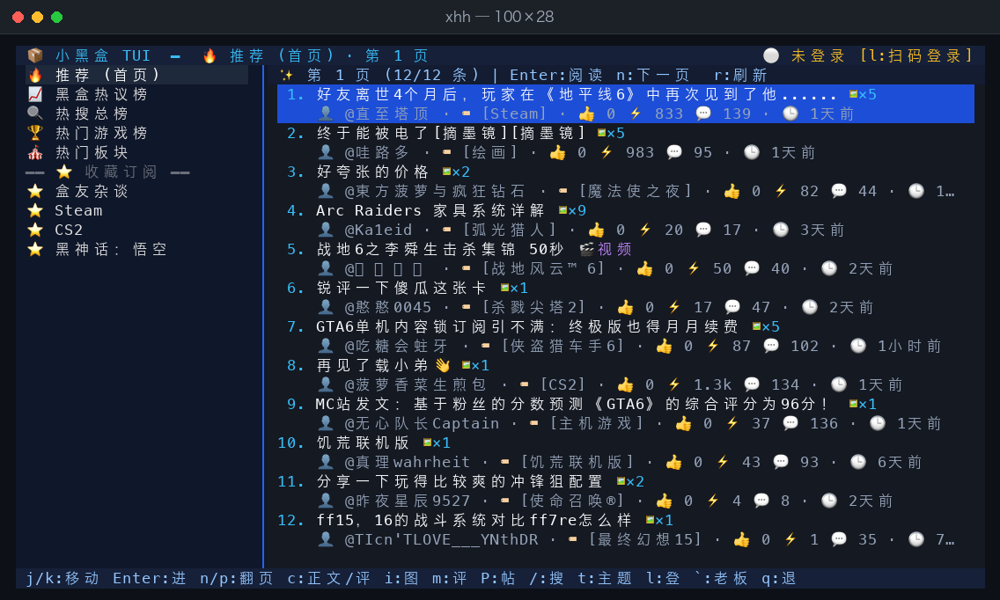
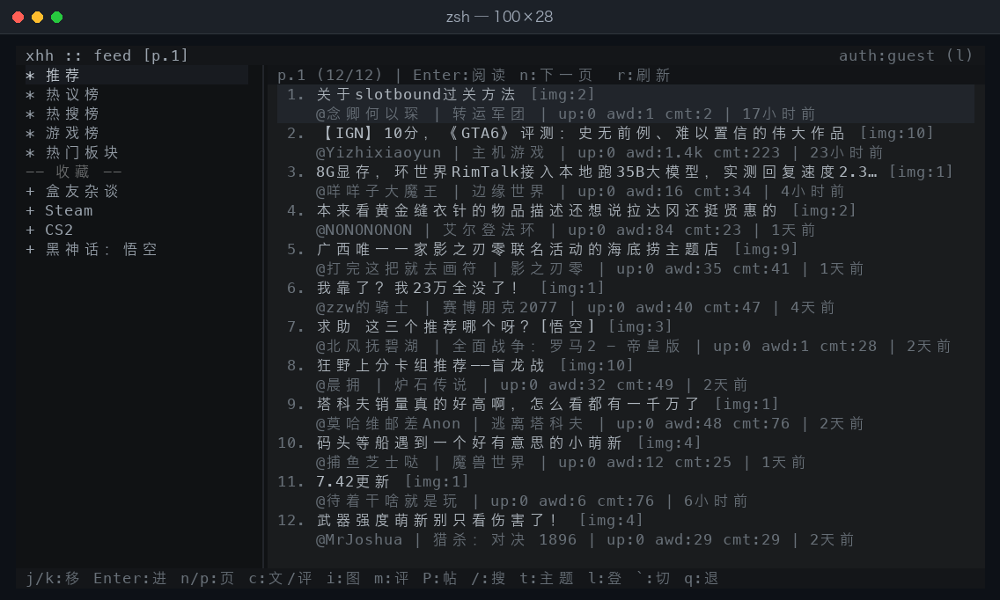
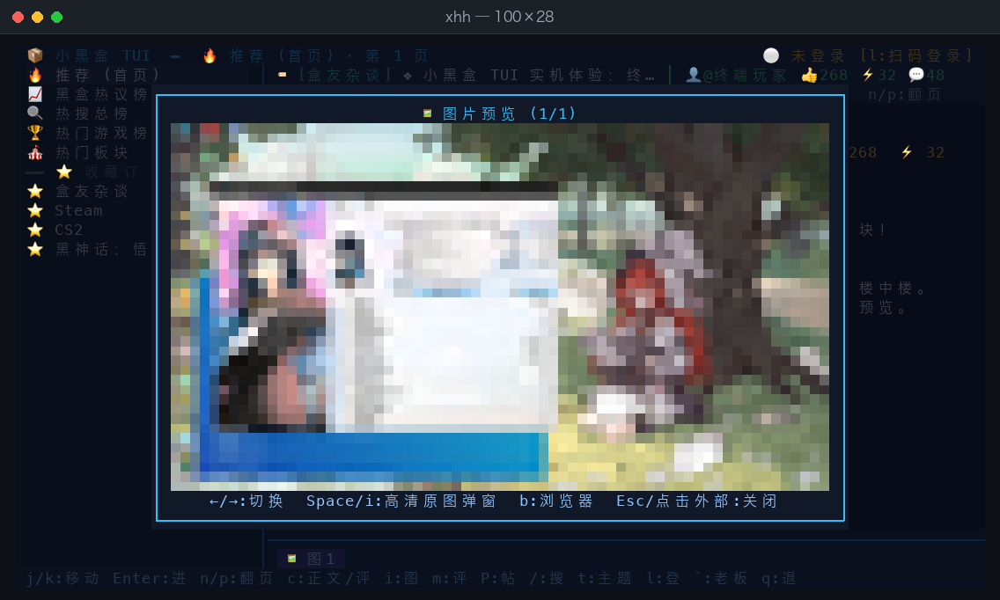

# 小黑盒社区 TUI (`xhh`)

在终端中沉浸式浏览小黑盒社区的交互式 **TUI** 应用（同时提供快捷 **CLI** 子命令与 JSON 输出）：支持 App 扫码登录、推荐流、热议/热搜/热门游戏榜、指定游戏板块筛选（综合/热点/排序）、帖子正文与楼中楼评论分离阅读、终端悬停看图、发评论与发帖。

<p align="center">
  
  
  
</p>

## 一键安装 (推荐)

### 方式 1：安装脚本一键安装（macOS / Linux）

无需手动管理虚拟环境，直接执行以下命令即可安装到 `~/.local/bin/xhh`：

```bash
curl -fsSL https://raw.githubusercontent.com/lucklyt/xhh/main/install.sh | bash
```

卸载：

```bash
curl -fsSL https://raw.githubusercontent.com/lucklyt/xhh/main/install.sh | bash -s -- --uninstall
```

### 方式 2：使用 `uv` 或 `pipx` 安装

```bash
# uv
uv tool install git+https://github.com/lucklyt/xhh.git

# 或 pipx
pipx install git+https://github.com/lucklyt/xhh.git
```

### 方式 3：源码克隆运行

```bash
git clone https://github.com/lucklyt/xhh.git
cd xhh
./xhh
```

> 提示：安装后直接运行 `xhh` 即可（本文档其余示例若从源码目录运行可使用 `./xhh`）。

## 快速开始

```bash
# 1. 启动全屏交互式 TUI（默认极简低调终端风 stealth，按 t 键或加 --theme elegant 切为华丽炫彩主题）
xhh
xhh --theme elegant

# 2. 终端扫码登录（使用小黑盒 App 扫码）
xhh login

# 3. 查看当前登录状态 / 退出登录
xhh whoami
xhh logout
```

## 快捷 CLI 子命令

```bash
# 查看首页推荐流
xhh feed -n 15

# 查看实时榜单（黑盒热议 / 热搜总榜 / 热门游戏榜）
xhh hot
xhh hot --tab news

# 搜索或列出热门游戏 / 社区板块
xhh topics
xhh topics -q 黑神话

# 查看指定游戏板块（支持游戏名或 topic_id）
xhh topic CS2
xhh topic CS2 --hot --sort reply -n 15
xhh topic 568547

# 阅读帖子正文与评论区（支持指定楼层范围、只看楼主与 JSON 结构输出）
xhh post <link_id>
xhh view <link_id> --floors 1-10
xhh post <link_id> --floors 20-35 --json
xhh --post <link_id> --floors 2-8 --json
xhh post <link_id> --owner --page 1

# 搜索游戏板块与帖子（支持 --json）
xhh search 黑神话
xhh feed -n 10 --json

# 发表评论与发布图文新帖（需先扫码登录 `xhh login`）
xhh comment <link_id> "说得太对了[cube_滑稽]"
xhh comment <link_id> "确实" --root-id <主评ID> --reply-id <目标评论ID>
xhh publish -t "测试标题" -c "帖子正文内容" --topic 盒友杂谈
xhh publish -t "图文推广标题" -c "正文内容" -i assets/tui_feed.png -i assets/tui_detail.png --topic 盒友杂谈
```

## TUI 全屏交互快捷键

| 快捷键 | 功能说明 |
| :--- | :--- |
| `j` / `k` / `↑` / `↓` | 列表上下移动；在正文区聚焦时上下滚动正文 |
| `h` / `←` / `→` / `Tab` | 在左侧导航栏与右侧内容区之间切换焦点 |
| `Enter` | 进入选中的板块、热榜条目或帖子详情；在评论上按 `Enter` 展开楼中楼 |
| `l` | 弹出 **扫码登录窗口**（`b` 浏览器打开高清码，`m` 切换紧凑模式，`r` 刷新，`u` 退出） |
| `/` | 弹出 **搜索窗口**（搜索游戏板块与帖子） |
| `1` / `2` | 在游戏板块内切换 **综合** / **热点** |
| `s` | 板块内切换帖子排序（智能/回复/最新）；评论视图下切换评论排序（热门/正序/倒序） |
| `f` | 收藏 / 取消收藏当前游戏板块（持久化至 `~/.config/xhh/config.json`） |
| `n` / `p` | 列表自适应单页刷新翻页（默认 10 条，随窗口高度自动调整）；正文整屏翻页；评论翻页 |
| `o` | 详情页切换 **只看楼主 / 全部评论** |
| `c` | 详情页在 **「帖子正文」** 与 **「评论区」** 视图间一键切换 |
| `t` | 一键切换 **双主题**：`stealth`（默认，极简终端灰阶、零 Emoji）↔ `elegant`（华丽夜空蓝、全彩图标） |
| `e` | 详情页展开当前选中评论的完整 **楼中楼回复** |
| `i` / 鼠标悬停图片胶囊 | 在终端内嵌预览图片（浮层内按 `Space` 可呼出 macOS QuickLook 高清原图） |
| `m` / `w` | 详情页发表主楼评论 (`m`) 或回复当前选中的评论 (`w`) |
| `P` (`Shift+P`) | 弹出发布新帖窗口 (`Ctrl+S` 提交) |
| `b` | 在系统默认浏览器中打开原帖（查看高清大图或视频） |
| `r` | 刷新当前视图 |
| `` ` `` (反引号) | **老板键 (Boss Key)**：瞬间切换为程序编译测试日志界面 |
| `Esc` / `Backspace` / `q` | 详情页返回帖子列表；主界面按 `q` 退出 |

## 会话与配置文件

- 登录会话：`~/.config/xhh/session.json`（权限 `0600`，可通过 `XHH_CONFIG_DIR` 覆盖目录）
- 板块收藏与主题偏好：`~/.config/xhh/config.json`（含 `theme`: `stealth` / `elegant`）
